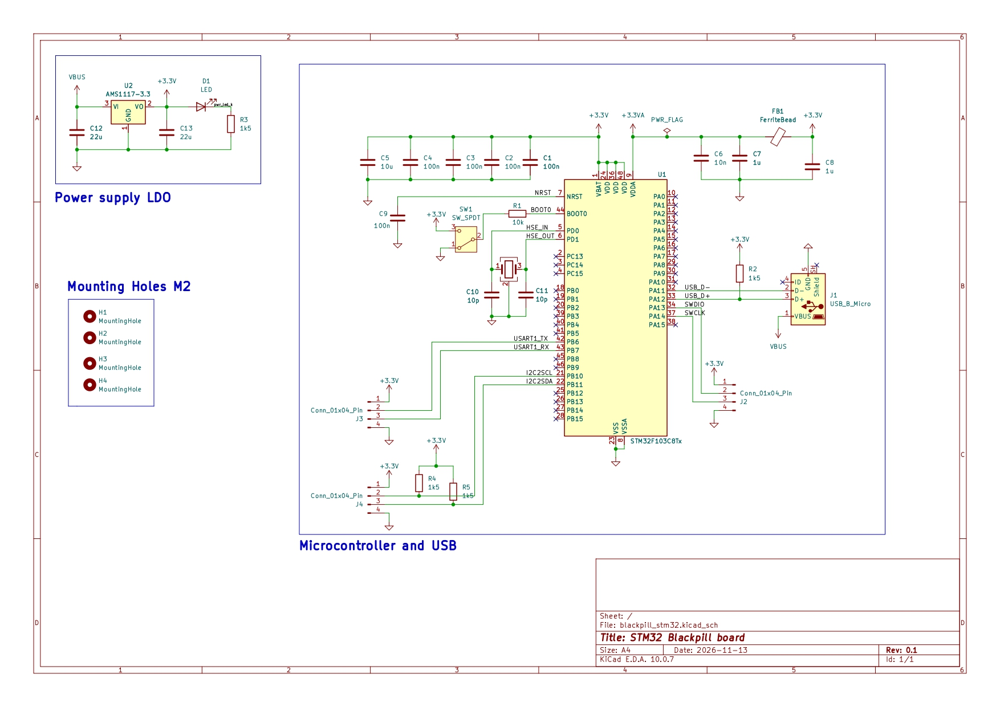
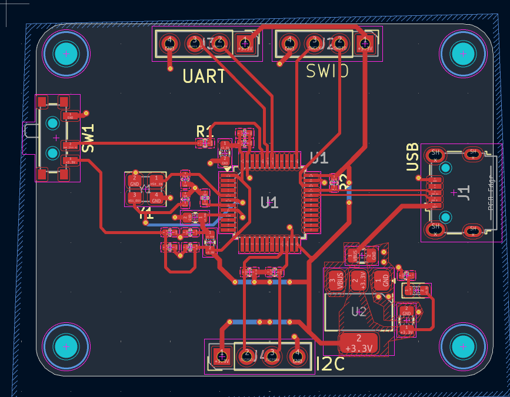

# Black Pill STM32 (STM32F103C8T6)

A STM32 development board designed in KiCad, inspired by the popular "Black Pill". I built it as a learning project in schematic capture and PCB design.

## What it does

The board is powered from a micro-USB connector, regulates the 5 V down to 3.3 V, and gives access to the pins of an STM32F103C8T6 microcontroller so it can be programmed and used in other circuits.

- **Microcontroller:** STM32F103C8T6, a 32-bit Arm Cortex-M3 running at up to 72 MHz, with 64 KB of flash and 20 KB of RAM.
- **Power:** USB VBUS (5 V) feeds an AMS1117-3.3 low-dropout regulator, with 22 µF capacitors on its input and output. A power LED indicates that the 3.3 V rail is present.
- **Analog supply:** the analog supply pin (VDDA) is filtered from the digital 3.3 V rail through a ferrite bead and capacitors, to reduce noise on the analog-to-digital converter.
- **Decoupling:** 100 nF capacitors sit next to the supply pins, with a 10 µF bulk capacitor.
- **Clock:** 8 MHz crystal with two 10 pF load capacitors on the high-speed external oscillator pins.
- **USB:** the USB data lines (D+ and D-) are connected to the microcontroller's USB pins, so it can act as a USB device.
- **Boot selection:** a slide switch sets the BOOT0 pin, which selects whether the chip starts from user flash or from the built-in bootloader.
- **Programming and debugging:** a 4-pin Serial Wire Debug (SWD) header (3.3 V, SWDIO, SWCLK, GND). The reset line (NRST) is also available.
- **Breakout headers:** 4-pin headers for I2C2 (SCL, SDA) and USART1 (TX, RX), which can also be used with the built-in serial bootloader.
- **Mechanical:** four M2 mounting holes.

## Schematic

## PCB layout

## References

- [STM32F103C8 product page and datasheet (STMicroelectronics)](https://www.st.com/en/microcontrollers-microprocessors/stm32f103c8.html)
- [AMS1117-3.3 datasheet (Advanced Monolithic Systems)](https://www.mikrocontroller.net/attachment/426034/AMS1117.pdf)
